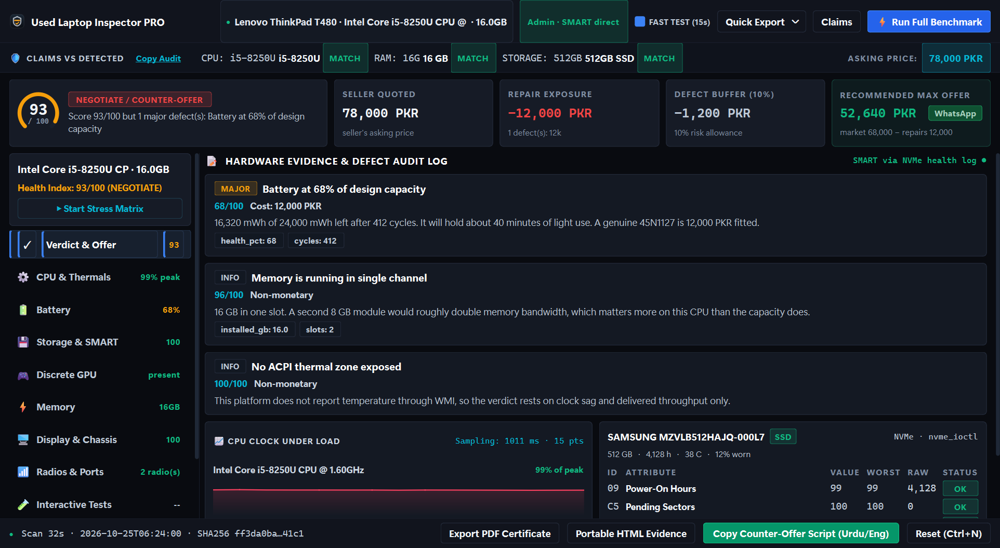
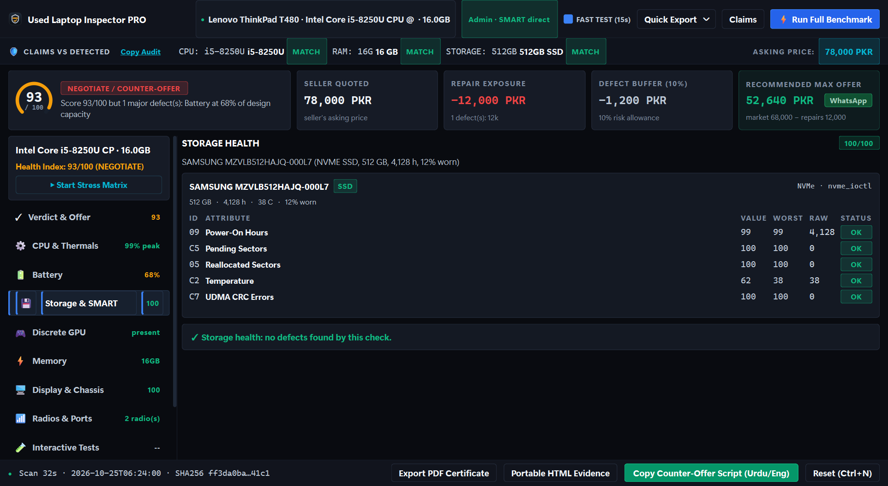
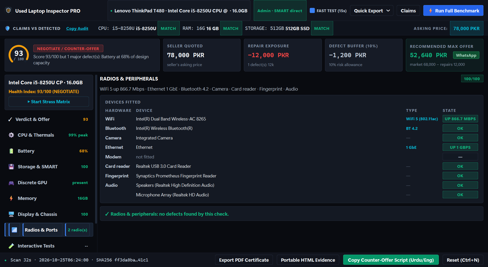
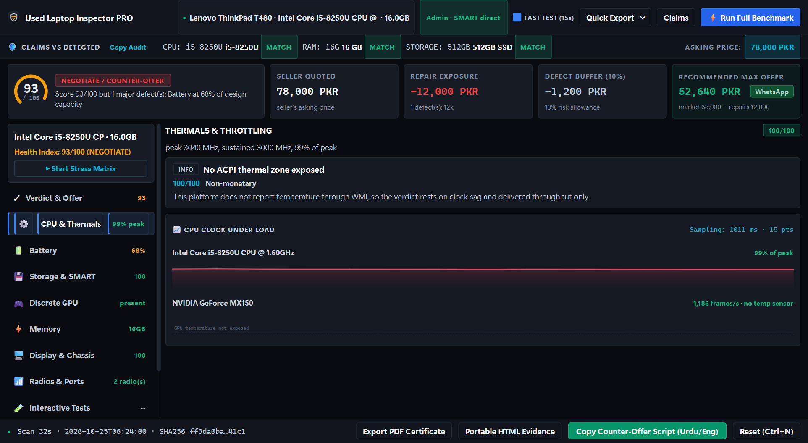
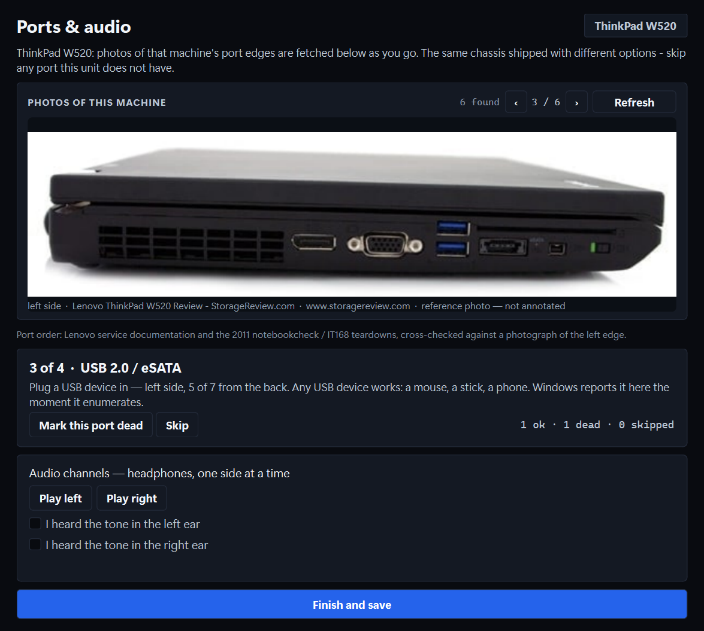

# Used Laptop Inspector

One scan on a laptop you are about to buy. A score out of 100, a verdict, and the
number to counter-offer with.

Built for the Hall Road / Rainbow Centre used market, where the seller controls
the machine and the buyer has ten minutes.



```
SCORE   93/100
VERDICT NEGOTIATE

Market value     68,000 PKR
Repairs          12,000 PKR   (battery at 68% of design capacity)
Fair value       56,000 PKR
Offer            52,640 PKR   ceiling 56,000

The seller wants 78,000. That is 28% above what the machine is worth
with its defects - offer 52,640 and do not go past 56,000.
```

**The offer is not a discount off the asking price.** It is what the machine is
worth minus what it costs to fix, so a seller who asks more does not get offered
more for the same faults.

---

## Screenshots

| | |
|---|---|
| **Verdict & counter-offer**<br> | **Storage, per drive**<br> |
| **Radios & peripherals**<br> | **Thermals under load**<br> |



*Screenshots are of a demo ThinkPad T480, not a real customer machine - the
tool strips serials from its own reports, and so do the marketing shots.*

---

## Run it

```bash
python -m venv .venv
.venv\Scripts\pip install -r requirements.txt

python main.py                    # GUI
python main.py --cli --elevate    # headless, full scan
python selftest.py                # 59 assertions, no hardware needed
```

The GUI asks for elevation on launch. Without it, storage health cannot be read -
opening `\\.\PhysicalDriveN` for SMART needs write access, which needs admin. The
report says so rather than pretending the drive is fine.

### CLI

```bash
# what the seller claimed, and what they are asking
python -m laptop_inspector.cli --elevate --asking 85000 \
    --claim cpu=i7-2820QM --claim ram_gb=16 --claim storage_type=nvme \
    --json out/report.json --pdf out/report.pdf --html out/report.html

# quick pass at the counter
python -m laptop_inspector.cli --elevate --fast
```

Exit code is `2` on WALK AWAY, so a script can branch on it.

### Build

```bash
pip install pyinstaller
pyinstaller build.spec --noconfirm
# dist/UsedLaptopInspector.exe   - GUI, and --cli for headless
```

The exe carries a `requireAdministrator` manifest, so Windows prompts once at
launch. `ULI_NO_UAC=1 pyinstaller build.spec` builds a non-elevating variant for
smoke-testing only.

---

## The verdict

Three states, decided by evidence rather than by score alone:

| Verdict | Condition |
|---|---|
| **BUY** | score >= 80, no major defects, nothing blocking |
| **NEGOTIATE** | score >= 55, or major defects present |
| **WALK AWAY** | any *blocking* finding, score < 55, or the seller is asking 45%+ above what the machine is worth |

A **blocking** finding is one where the machine is not worth having at any price:
sectors pending reallocation, a drive past 90% endurance, a display driver that
resets under load, or a seller who lied about the CPU, the RAM or the drive type.
A worn battery is expensive, not blocking - it is a 15,000 PKR deduction.

Weights and thresholds live in `laptop_inspector/scoring/rubric.py` and
`laptop_inspector/data/costs_pkr.json`. See [RUBRIC.md](RUBRIC.md).

---

## Layout

```
laptop_inspector/
├─ engine/                 # headless. imports no Qt, ever
│  ├─ inspector.py         # orchestrator: collect, run checks, score
│  ├─ context.py           # Options + shared state passed to checks
│  ├─ result.py            # Finding / CheckResult / Report dataclasses
│  ├─ winapi.py            # ctypes: SMART, NVMe, MSDM, clocks
│  ├─ powershell.py        # CIM collectors, one spawn per group
│  ├─ perf.py              # PDH % Processor Performance
│  ├─ loadgen.py           # CPU load workers + throughput sampling
│  ├─ d3d11.py             # GPU stress, isolated in a child process
│  ├─ remnants.py          # registry / DriverStore / PCI traces of a dead dGPU
│  ├─ util.py              # parsing, GPU classification, SMBIOS enums
│  └─ checks/              # specs, battery, storage, thermal, gpu, dgpu
├─ scoring/                # rubric.py, negotiation.py
├─ report/                 # pdf_canvas.py (pure python), pdf_report, html, json
├─ ui/                     # PySide6 only
├─ data/                   # models.json (60 laptops), costs_pkr.json
└─ cli.py
```

The rule that matters: **`engine/` must not import Qt.** That is what lets the
same inspection code run from WinPE later without a rewrite.

---

## Decisions

**smartmontools is GPL - not used, not bundled.** The tool talks to the drive
directly. This took two attempts to get right, and the second one matters:

`SMART_RCV_DRIVE_DATA` **does not work on Windows 11.** It returns
`ERROR_ACCESS_DENIED` (5) even for an elevated process holding a write handle to
`\\.\PhysicalDriveN`, with every struct-size variant tried. Verified on both
drives of the W520. Windows now gates it to signed callers.

The transport that does work is `IOCTL_STORAGE_PREDICT_FAILURE`, which returns
`STORAGE_PREDICT_FAILURE { DWORD PredictFailure; BYTE VendorSpecific[512]; }` -
and that 512-byte block is the standard SMART data block, identical layout, so
attribute parsing is shared. `winapi.smart_block()` tries NVMe, then
`SMART_RCV_DRIVE_DATA`, then `PREDICT_FAILURE`, and records which one answered
(`transport` in the JSON) so a silent downgrade is visible.

This keeps the app proprietary and shippable, removes a 10 MB dependency, and
avoids a licensing question every commercial customer would ask. `smartctl` is
not called even if present.

**No Sysinternals.** Licence does not permit redistribution. The checks that
would have used them are reimplemented: TDR history from the event log via
`Get-WinEvent`, GPU state from PnP, SMART from IOCTLs.

**No multiprocessing.** CPU load runs on threads inside a `hashlib.sha256` loop,
which releases the GIL and drives every core to 100 % (measured). The earlier
process-based version cost a full 47 MB bundle re-extraction per worker in the
frozen exe and could stall a second scan for 30 s.

**Elevation is mandatory, and requested honestly.** A scan without admin produces
a report that says storage health is unavailable, and the report says why. It
does not score the drive as healthy.

**Offline by default, with one deliberate exception.** No telemetry, no account,
no update check, no licence server. The scan itself never opens a socket:
`laptop_inspector/engine/checks/` and the report writers have no network code at
all, so a machine in a shop basement with no signal still produces a full report.

The single exception is the port test's **photo lookup** (`engine/webimages.py`),
which is the one place the tool reaches out, and only to find a picture of the
laptop it is already testing. It is opt-in by action rather than by flag: nothing
is fetched until the port dialog opens or the buyer presses *Find photos*. If the
network is down, blocked or slow, the lookup returns nothing after its timeout
and the drawn port strips carry the test on their own. Results are cached under
`%LOCALAPPDATA%\UsedLaptopInspector\webcache`, so a second run needs no network
at all.

Two providers, in this order:

1. **Wikimedia Commons** - licensed and attributed, so the author and licence can
   be shown next to the photo.
2. **Bing image search** - far better coverage for a specific model's port edge,
   which is what actually finds a photo of a W520's left side. Results are
   arbitrary web images, so they are captioned as *reference photo, not
   annotated* with the source host, never presented as a diagram.

The model number is what has to match: filtering on the brand alone let W540 and
W550s photos through when asked for a W520. That filter, the licence check, the
ranking and the side detection are covered by offline tests that feed canned
responses through the parsers - see `test_webimages` in `selftest.py`.

**Everything degrades.** A 2013 laptop with no NVMe, no ACPI battery data and no
thermal zone still produces a full report with those checks marked unavailable
and excluded from the weighted score - not scored zero, which would punish the
machine for the tool's blind spots. Verified on the W520 this was built on, which
reports no battery capacity and no thermal zone at all.

---

## What is verified, and how

`python selftest.py` - 138 assertions, no hardware, no admin:

- ATA SMART attribute table parsed from a synthetic 512-byte buffer, including
  48-bit raw values and SSD life-left inversion
- NVMe SMART/Health log parsed from a synthetic buffer, including the 128-bit
  data-unit counters and the critical-warning byte
- MSDM product key recovery, both dashed and contiguous, and rejection of
  truncated tables
- ATA IDENTIFY word-swap
- rubric weighting, including that unavailable checks leave the denominator
- negotiation arithmetic: the offer must not move when only the asking
  price moves, fair value must never be exceeded, and a blocking defect
  must walk away rather than discount
- model database: every regex compiles, the W520 matches on both its family
  string and its bare machine-type code

Verified on real hardware (ThinkPad W520, 4282AC5):

- **SMART reads on both drives** through `IOCTL_STORAGE_PREDICT_FAILURE`:
  Transcend 256 GB SATA SSD at 3,619 h / 36 C / 740 interface CRC errors, and a
  Toshiba 1 TB SATA HDD at 36,768 h with **24 sectors pending reallocation** -
  which correctly produces a blocking CRITICAL and a WALK AWAY verdict
- dGPU check identified a Quadro 2000M that was disabled in BIOS, from the
  phantom PnP record, nine DriverStore packages and a `VEN_10DE` PCI entry, with
  only the Intel HD 3000 enumerated. After the card was re-enabled, the same
  check flipped to OK with both adapters listed - the false-positive and the
  true-negative both confirmed
- thermal probe held 2.9 GHz on a 2.3 GHz base under all-core load (turbo
  sustained), throughput did not decay, 63 C reported
- battery check correctly distinguished "enumerates but reports zero capacity"
  from "no battery", and corroborated it with 172 kernel-power events in 180 days
- pre-Windows 8 machine with no MSDM table is reported as expected, not as a defect

### Not yet verified - needs the Quadro enabled

1. **Optimus / dual-GPU enumeration.** Confirmed: with the Quadro re-enabled the
   dGPU check flips to OK and `gpu` lists both adapters.
2. **TDR detection.** The event-log path is exercised (0 events found), but the
   device-removed path in `d3d11.py` only fires on a real driver reset. Force one
   with a known-bad overclock, or trust the HRESULT handling.
3. **GPU load test.** Currently reports `inconclusive` on this machine: the D3D11
   device and render target are created successfully, but `ClearRenderTargetView`
   returns an unrecognised status, so the probe declines to judge the hardware
   rather than blame it. Under Optimus the clear may be landing on a different
   adapter than the one the texture was made on. Worth fixing before shipping,
   because it is the only check that can catch a GPU that fails under load
   rather than at idle.
4. **NVMe SMART.** No NVMe drive on the W520. The parser is covered by selftest,
   the IOCTL path is not.

---

## Known limits

- **The seller controls the machine.** A rootkit can lie about SMART, and a
  modified ACPI table can lie about the battery. This is why the architecture
  keeps `engine/` free of UI dependencies: the same checks run from a bootable
  USB, where the seller's Windows is not in the loop. That is the real fix, and
  it is not in this version.
- **`powercfg /batteryreport` can be absent** on machines with no ACPI battery
  driver. The check falls back to `root\wmi`, then to Win32_Battery, then reports
  unavailable.
- **Temperature is opportunistic.** `MSAcpi_ThermalZoneTemperature` is missing on
  a lot of consumer hardware. Throttle detection therefore rests on actual clock
  (PDH) plus delivered throughput, which is a better signal anyway.
- **The model database covers 60 laptops.** Unknown models return
  `unavailable` for the dGPU check rather than guessing. Add entries to
  `data/models.json` as you meet them.

## Running without the seller's Windows

There is a second build for WinPE: boot your own image from a USB stick and scan
the laptop with its own operating system not running at all. That removes the OS
from the list of things that can lie to you - no shimmed SMART tool, no spoofed
CPU string, no rootkit hiding a failing drive.

    pyinstaller build_pe.spec --noconfirm --distpath dist_pe   # ~10 MB, no Qt

The engine imports no GUI toolkit, and a test enforces that: if anyone adds a
`PySide6` import to `engine/`, `scoring/` or `report/`, the suite fails. That is
what makes the headless build possible without a second copy of the logic.

The GPU load test cannot run there (no D3D11 in WinPE) and the peripherals check
reports "not visible in this boot environment" rather than claiming hardware is
missing - WinPE only enumerates devices whose drivers are in the image.

See `pe/README.md` for the ADK steps, and for what this does **not** protect
against: firmware can be reflashed, and some drives accept a command that wipes
their SMART history.

## What the machine is worth, and what to offer

The offer is **not** derived from the asking price. It used to be
(`offer = asking - repairs`), which meant a seller asking 80,000 was offered
38,750 for a machine that got 18,750 at 60,000 — identical defects, a higher
offer, purely for asking more. That is backwards, and it is the kind of thing a
buyer would only notice after being burned.

    fair value = market price - repair cost
    offer      = fair value, less ~6% room to negotiate
    ceiling    = fair value

The asking price is now only used to judge the deal: above fair value, push back;
already below it, pay and stop arguing.

**Where the market price comes from**, in order:

1. **What the buyer typed.** A reseller knows the local market better than any
   search does, and this is remembered per model, so it is stated once.
2. **What the buyer typed last time** for the same model, read back from
   `%LOCALAPPDATA%\UsedLaptopInspector\market_prices.json`.
3. **A web search** for used listings of that model, median of the prices found,
   cached for a week. Best-effort: DuckDuckGo and Bing both rate-limit and
   challenge automated queries, so this is a convenience, never the foundation.
4. **Nothing.** Then the old asking-anchored maths runs, and the advice says so
   out loud rather than hiding the flaw.

The basis is printed under the number — *"market 45,000 − repairs 23,000"* — so
the figure can be checked instead of trusted.

## Radios and peripherals

WiFi, Bluetooth, camera, Ethernet, modem, card reader, fingerprint reader and
audio are enumerated from PnP and `Get-NetAdapter`, then classified into the three
states that get confused constantly:

* **absent** - the machine never had it. Reported, never scored, because plenty
  of configurations shipped without Bluetooth or a webcam.
* **present and healthy** - the driver loaded and the device reports OK.
* **present and broken** - a PnP problem code, an error status, or a radio
  switched off. Scored, with a repair cost.

Two traps this check had to be taught:

- **`CM_PROB_PHANTOM` is not a fault.** Windows keeps records of hardware it can
  no longer see; counting those invented a broken card reader and three broken
  audio devices on the first run.
- **Network adapters do not report PnP statuses.** They report `Up` and
  `Disconnected`, and an unplugged Ethernet cable is not a broken port. Virtual
  adapters (TAP, Wintun, Npcap, VPN) also claim `802.3` and have to be filtered
  out or every machine with a VPN client looks like it has four NICs.

**The type is reported, not just the name.** WiFi shows its generation
(802.11be/ax/ac/n → WiFi 7/6/5/4) from the amendments the driver claims;
Bluetooth shows its spec version; Ethernet shows the port class (1 GbE, 2.5 GbE,
10 GbE) taken from the driver's speed/duplex capability list. That last one
matters because a NIC with no cable in reports 0 bps, so the negotiated link says
nothing about what the port can do — the capability list does.

What it does **not** do is prove data flows: a WiFi link cannot be proven without
a network to join, and capturing a camera frame needs Media Foundation. The
report says "present and healthy", and the detail text says so rather than
implying a connection test happened.

## v2 — interactive tests

Three checks that no API can perform, because they need a human:

**Screen.** Ten fullscreen patterns in the order that exposes different faults -
white and black for stuck pixels, RGB and grey for dead subpixels, a gradient for
banding, a checkerboard for single stuck pixels, a 1px grid for dead columns.
The buyer advances with Space and answers one question about what they saw.

**Keyboard.** An on-screen matrix of 77 observable keys. Three details make it
work rather than merely run:

- **Left and right modifiers are separate.** Qt sends the same `Key_Shift` for
  both sides, so a matrix keyed on the Qt code lights up both shifts when you
  press one. Windows reports the generic `VK_SHIFT` too, so the side comes from
  the scan code: `0x2A` left, `0x36` right, `0xE01D` / `0xE038` for right Ctrl
  and Alt.
- **Tab is claimed before focus traversal.** Qt consumes Tab in
  `focusNextPrevChild`, so it never reaches `keyPressEvent`. Intercepted in
  `event()` and the traversal override returns false.
- **Space and Esc are claimed for the same reason** - Space activates the focused
  button, Esc is answered by `QDialog`.

Fn and the media row are excluded: they are handled in firmware and never reach
an application, so counting them would fail every machine.

**Ports and audio.** The machine is looked up in `data/port_layouts.json`, and the
dialog shows **photographs of that exact model**, fetched from the web as the
test runs, with the port to plug into named and positioned: "USB 2.0 / eSATA -
left side, 5 of 7 from the back".

There is no drawing. An earlier version rendered its own side elevation of the
ports; it was removed, because a drawn diagram is an interpretation and a
photograph of the actual machine is not. The photo is captioned with its source
and marked *reference photo, not annotated*.

**The layout has to be sourced.** The first version was drawn from memory and had
the W520's two USB 3.0 ports on the wrong side, the audio jack on the wrong side,
and Ethernet at the rear. The W520 entry now comes from Lenovo's service
documentation and the 2011 notebookcheck and IT168 teardowns, cross-checked
against a photograph of the left edge, and `selftest.py` pins the order so it
cannot drift. A model without a sourced layout gets the generic one and the UI
says so, rather than guessing a chassis.

Detection is `RegisterDeviceNotification` on `GUID_DEVINTERFACE_USB_DEVICE`, so
any USB device works - a mouse, a stick, a phone. The previous version listened
for volume arrivals, which only ever fired for USB storage, which is why it
looked broken with anything else. One physical device announces several
interfaces; the watcher debounces and keys by device so a single plug counts
once.

Alongside the drawn strips the dialog shows **photographs of the actual
model**, found on the web while the test runs: the detected family is searched
for, and the result whose file name matches the side being tested is brought
forward. That is how the DisplayPort/VGA order got corrected - a StorageReview
side-on photo of the left edge showed DisplayPort nearest the vent, not VGA.

Results feed the same rubric as everything else: each defect carries a severity
and a repair cost, so a backlight bleed becomes an 18,000 PKR line in the
counter-offer. Skipping the tests leaves the check `unavailable` and out of the
weighted score.

## v2 — stress lab

The CPU and GPU load tests can be run by hand, separately, with the numbers
moving while they run:

**CPU.** Every core loaded with GIL-releasing hashes; the live clock, CPU load
and delivered throughput are plotted as they are sampled. The finished probe is
scored by the same rules as the scan (`thermal.from_probe`), so a hand-run test
replaces the scan's result rather than adding a second opinion.

**GPU.** DXGI is enumerated first and the **discrete adapter is chosen
explicitly**. On an Optimus laptop the default D3D11 device is the Intel iGPU, so
a test that asks for "the hardware device" hammers the wrong chip and then
reports the Quadro as healthy. The device is created on the discrete adapter with
`D3D_DRIVER_TYPE_UNKNOWN`, and the adapter actually used is printed under the
number - "NVIDIA Quadro 2000M · feature level 11_0" is not a claim you can fake.

**It draws real frames.** The first version cleared a render target in a loop.
A driver collapses repeated clears of a target nothing reads, so the card sat at
0 % in Task Manager while the probe reported a large number - a fake result
dressed up as a measurement. The load is now a fullscreen triangle with an
ALU-heavy pixel shader, compiled at runtime with `D3DCompile`, drawn repeatedly,
with the render target copied to a staging texture and mapped back each frame so
the rate is bound by the GPU finishing rather than the CPU submitting. Measured
at ~1,100 fps at 720p on a Quadro 2000M, which is a plausible number for that
card; the old "384,000 clears/sec" was not.

Failures are detected through `ID3D11Device::GetDeviceRemovedReason`, because
`ClearRenderTargetView` returns **void** - reading its return register produced a
different garbage HRESULT every run.

**Vtable slots are read from the header, never remembered.** Three separate
guesses at `ClearRenderTargetView` (49, then 46) were wrong and each produced a
plausible-looking result that meant nothing. The slots now come from
`ID3D11DeviceContextVtbl` in the mingw-w64 `d3d11.h`, and `stress()` calls
`GetType` first: an immediate context returns 0, and if it does not, the probe
refuses to report rather than inventing a number. That guard is the difference
between a measurement and a fabrication.

`gpu.apply_stress` swaps the load-test findings on an existing check and rescales
from the score it had before the previous stress result, so re-running never
double-penalises.

Still open: a bootable WinPE build, so the checks run outside the seller's
Windows.
